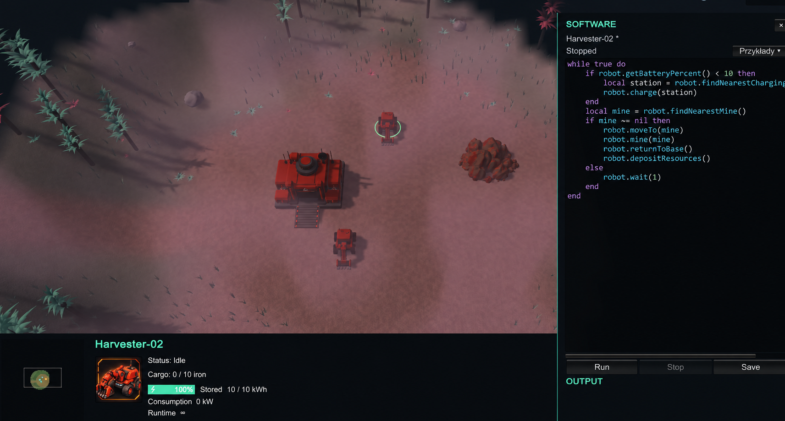

# Protocol

**A real-time strategy game about building a robotic colony on an alien planet — with units programmed in Lua.**

Expand your base, gather resources, and keep your colony powered. Write robot programs to automate harvesting, deliveries, and charging. When a unit runs out of battery, send a Hauler to recover it and bring it to a charging station.

> Protocol is an actively developed prototype. It currently includes one playable scenario; mechanics, balance, and visuals are still evolving.

## Gameplay

The colony is built around three connected systems: **resources, power, and automation**.

- **Resources:** mine iron, harvest wood from trees, and deliver cargo to the base.
- **Infrastructure:** build solar panels, charging stations, and battery storage.
- **Colony power grid:** generation, consumption, and stored energy share a single power balance.
- **Robot batteries:** units have independent batteries; movement and work consume energy.
- **Exploration:** a minimap and fog of war track explored terrain and colony positions.
- **Planet environment:** the day/night cycle affects temperature and solar availability. The environment system also tracks Wind, Dust, EM Activity, and Radiation.
- **Software:** a sliding Lua editor provides syntax highlighting, autocomplete, undo/redo, and Run / Stop / Save controls.
- **Save Game:** named saves restore the colony state and ongoing robot actions.

### Units and buildings

| Element | Role |
| --- | --- |
| **Base** | Resource storage, robot production, and the grid's initial energy storage |
| **Harvester** | Iron mining, tree harvesting, and resource delivery |
| **Assembler** | Construction of power infrastructure |
| **Hauler** | Recovery of depleted Harvesters and Assemblers to a charging station |
| **Solar Panel** | Power generation based on the planet's Solar parameter |
| **Charging Station** | Charging one robot at a time from the colony grid |
| **Battery Storage** | Additional capacity for the shared energy reserve |

Power is measured in **kW**, while stored energy is measured in **kWh**. Systems use simulation time. The button next to the planet icon switches between **1× and 4×** speed; the pause menu stops the simulation.

## Getting started

### Requirements

- **Unity 6000.4.7f1**, as specified in [ProjectVersion.txt](ProjectSettings/ProjectVersion.txt).
- **Unity Hub** to install the editor and open the project.
- **Git LFS** — WAV music files are stored through LFS.
- For Windows builds: **Windows Build Support** for your selected scripting backend.

### First launch

1. Clone the repository.
2. Download the LFS files from the project directory:

   ~~~sh
   git lfs install
   git lfs pull
   ~~~

3. In Unity Hub, select **Add project from disk** and choose the directory containing Assets, Packages, and ProjectSettings.
4. Open the project with Unity **6000.4.7f1**. Wait for asset imports and script compilation to finish.
5. Open **Assets/Scenes/MainMenu.unity** and enter **Play** mode.
6. Select **Scenarios → Scenario 1**. To resume a saved session, select **Load Game**.

Some in-game labels currently use Polish: **Scenariusze** means Scenarios, and **Scenariusz 1** means Scenario 1.

Unity recreates the local Library and Temp directories during import. The first launch can take longer; these directories are not committed to the repository.

### Building for Windows

1. Open **File → Build Profiles** and select a Windows profile.
2. Check the scene list: **MainMenu** first, followed by **Stage01**. Both are already included in the project settings.
3. Select **Build** or **Build And Run**, then choose an output directory such as Build/.
4. Launch the generated executable.

The build dialog determines the output location. Build/ and Builds/ are ignored by Git.

### Editing C#

Open **Protocol.slnx**, or use **Assets → Open C# Project** in Unity. The solution provides cross-script references and IntelliSense. Opening individual C# files outside the solution does not provide the full project context.

## Controls

| Action | Control |
| --- | --- |
| Select a unit, building, or deposit | Left mouse button |
| Select a group of robots | Drag with the left mouse button |
| Move selected robots | Right mouse button on the map |
| Move the camera | WASD or arrow keys |
| Move the camera faster | Shift |
| Drag the camera view | Middle mouse button |
| Zoom in / out | Mouse wheel |
| Return the camera to the base | Home |
| Move the camera using the minimap | Left-click or left-drag |
| Issue movement using the minimap | Right-click |
| Pause menu and Save Game | Escape |
| Open unit or base Software | Monitor icon in the selection panel |
| Open Planet Environment | Planet icon in the top-right corner |
| Toggle simulation speed, 1× / 4× | Button next to the planet icon |

Opening Software does not pause gameplay. While typing in the editor, keyboard input goes to the code editor instead of camera controls.

## Programming with Lua

Each robot has its own interpreter, source code, program state, and battery. Groups of units **of the same type** can be programmed together.

This Harvester example mines iron from the nearest available deposit and delivers it to the base:

~~~lua
while true do
    local mine = robot.findNearestMine()

    if mine ~= nil then
        robot.moveTo(mine)
        robot.mine(mine)
        robot.returnToBase()
        robot.depositResources()
    else
        robot.wait(1)
    end
end
~~~

Actions such as moveTo(), mine(), and wait() suspend the individual program until the action finishes, without blocking the game's main thread.

The base has its own production API and read-only access to stored resources:

~~~lua
if economy.wood >= 200 then
    buildHauler()
end
~~~

The API also provides buildHarvester() and buildAssembler(). Production takes time and requires both resources and power.

**The editor is read-only while a program is running.** Use **Stop** before editing. **Save** in Software saves the program; **Save Game** saves the gameplay session.

| Editor shortcut | Action |
| --- | --- |
| Ctrl+Space | Show API and variable suggestions |
| robot. | Show robot method suggestions |
| Up / Down arrows | Navigate the suggestion list |
| Enter / Tab with suggestions open | Accept the selected suggestion |
| Tab / Shift+Tab | Indent with four spaces / remove indentation |
| Ctrl+Z / Ctrl+Y | Undo / redo edits |

Examples: [mining](Docs/Examples/auto_mining.lua), [wood harvesting](Docs/Examples/auto_wood.lua), and [base production](Docs/Examples/base_production.lua). Recovery and charging APIs are covered in the [Hauler documentation](Docs/Hauler.md).

## Saves and settings

**Escape → Save Game** lets you name a save. Every save creates a separate list entry, even when names repeat. In the main menu, choose **Load Game**, select an entry, and load it.

Saves are stored under **Application.persistentDataPath/Saves**. They include resources, robots, infrastructure, batteries, production and construction progress, charging, exploration, world time, and ongoing Lua actions. Programs saved through Software and game settings are stored separately. See [Save Game / Load Game](Docs/SaveGame.md) for details.

Game settings include screen resolution, the frame-rate cap, music playback, and music volume. The default cap is **120 FPS**.

## Technology and project structure

Protocol uses **Unity**, **URP 17.4.0**, **Unity NavMesh**, the **MoonSharp** Lua interpreter, and **Pure Volumetric Fog**.

~~~text
Assets/
├── Art/Resources/       Models, materials, portraits, and cursor
├── Editor/              Scene, model, and validation tools
├── Music/               Game music
├── Plugins/MoonSharp/   Lua interpreter
├── Scenes/              MainMenu and Stage01
└── Scripts/
    ├── Camera/          RTS camera
    ├── Economy/         Resources, production, construction, and power grid
    ├── Lua/             Runtime, API, and software editor
    ├── Movement/        Movement and navigation
    ├── Robots/          Behaviors, batteries, charging, and towing
    ├── Saving/          Gameplay persistence and restoration
    ├── Selection/       Unit and object selection
    ├── UI/              HUD, menus, minimap, and panels
    └── World/           Scenario, terrain, and environment
Docs/                    Documentation, Lua examples, and screenshots
Packages/                Unity dependencies
ProjectSettings/         Project settings
~~~

## Documentation and validation

- [Lua API](Docs/LuaAPI.md)
- [Robot energy](Docs/robot-energy.md)
- [Planet Environment](Docs/planet-environment-system.md)
- [URP rendering](Docs/urp-rendering.md)
- [Hauler, recovery, and charging](Docs/Hauler.md)
- [Save Game / Load Game](Docs/SaveGame.md)

Some linked documentation describes earlier development stages and may be written in Polish. Current component and scene configurations are the source of truth for balance values.

Unity provides **Protocol → Validate Planet Environment**, **Validate Robot Energy**, **Validate Battery Storage**, **Validate Save Game**, and **Validate Hauler Gameplay** tools. Run checks that require Play mode in a separate test session: they may reload the scene and create test objects. Reports are written to the ignored Artifacts/ directory. Exit Play mode after testing.

## Contributing and licenses

Branch, commit, and merge conventions are documented in [AGENTS.md](AGENTS.md). Do not commit local Unity caches, builds, or Artifacts/. Preserve .meta files when moving assets.

The repository does not currently contain a top-level LICENSE file. Third-party dependencies and assets retain their own licensing terms, including [MoonSharp](Assets/Plugins/MoonSharp/LICENSE.txt).
